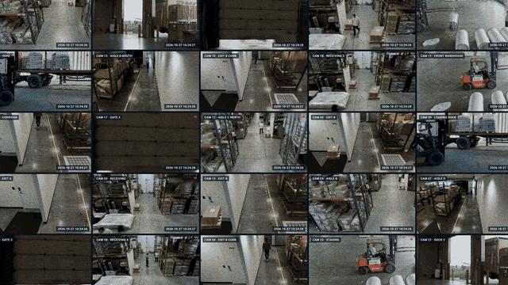

<div align="center">



<br/>

[](#what-your-agent-learns)
[](#quick-start)
[](#which-agents-can-use-this)
[](LICENSE)

**Point your AI agent at this repo and say _"set up my video studio."_**
<br/>Twenty minutes later it can write, animate, edit, subtitle and render real videos — on its own.

</div>

---

## See it work

A 60-second product launch film — concept, motion design, scene timing, music sync and the final 4K render —
made **entirely by an AI agent** inside this studio. No video editor was opened.

<p align="center">
  
  <br/>
  <em>5× speed preview — <a href="media/demo.mp4">▶ watch the full film with sound (1080p, 70 s)</a></em>
</p>

The prompt that started that film was roughly:

> Make a 60-second launch film for my product. Dark, confident, Apple-keynote pacing.
> Eleven scenes: the problem, the idea, deployment, live alerts, a replay, charts, and a closing title.
> Animate everything in HTML/CSS/JS, sync the cuts to the soundtrack, then render it at 4K.

## What is this?

AI agents are already great at writing code. Video editing *is* code — if you give the agent the right
instincts and tools. This repo is a **self-contained installer + skill pack** that rebuilds the same
known-good video studio on any machine, at pinned versions:

- **[ReelMimic](https://github.com/edenfunf/reelmimic)** — make a new video in the style of any reference video, with its web app and HyperFrames motion-graphics engines
- **106 video skills** — step-by-step expert playbooks the agent reads before each kind of job
- **The animation stack** — Remotion, Motion Canvas, GSAP, anime.js, three.js, vite
- **A private Python toolbox** — Whisper (faster-whisper), OpenCV, PySceneDetect, librosa, yt-dlp — in its own venv, so your global Python is untouched
- **[OpenFilm](https://github.com/openfilm/openfilm) + [youtube-clipper](https://github.com/op7418/Youtube-clipper-skill)** — films as web pages, and YouTube clipping with bilingual subtitles

Everything is bundled in `payload/` as slim archives pinned to exact commits, so the setup still works even
if an upstream repo disappears. The installer checks what's missing, installs it, and **verifies the result**
instead of just claiming success. Rerunning is safe — finished steps are skipped.

## Quick start

**With Claude Code (as a skill):**

```bash
git clone https://github.com/o-messai/video-studio-setup ~/.claude/skills/video-studio-setup
```

then just ask:

> set up my video studio

**With any other agent (ChatGPT/Codex, Gemini CLI, Grok, Cursor…):** clone the repo anywhere and tell your
agent to read [`AGENTS.md`](AGENTS.md) and follow it. The playbook is plain markdown + plain scripts.

**Or run the installer yourself:**

```powershell
# Windows — check first, then install (-InstallPrereqs lets winget install Node/Python/FFmpeg/Chrome)
powershell -NoProfile -ExecutionPolicy Bypass -File scripts\setup.ps1 -CheckOnly
powershell -NoProfile -ExecutionPolicy Bypass -File scripts\setup.ps1 -InstallRoot C:\studio\reelmimic
```

```bash
# macOS / Linux
bash scripts/setup.sh --check-only
bash scripts/setup.sh --install-root ~/reelmimic
```

## Prompts to try after setup

Open your agent **in the ReelMimic folder** (that's where the 104 project skills load) and try:

| You say | What happens |
|---|---|
| *"Make a 30-second launch video for my app — bold typography, dark theme, synced to an energetic track, 4K."* | The agent plans scenes, animates them in HTML/JS, times the cuts and renders an MP4 |
| *"Here's `reference.mp4`. Make the same style of video, but about my product."* | ReelMimic style-cloning: shot analysis, then a new video in that visual language |
| *"Take this YouTube link, find the 3 best moments, cut them into vertical shorts with burned-in bilingual subtitles."* | youtube-clipper: download, Whisper + scene analysis, clipping, subtitle burn-in |
| *"Turn this CSV into an animated bar-chart race with a lower third and my logo."* | Data-animation + lower-thirds skills |
| *"Kinetic-typography video of this quote, 15 seconds, square, for Instagram."* | Kinetic-typography skill, rendered to spec |
| *"Storyboard a 45-second ad for a coffee brand: shot list, camera moves, prompts for an AI video model."* | cinematic-director: beat sheet, blocking, per-shot prompts |
| *"Explain how our API works as a 90-second whiteboard explainer."* | Explainer + whiteboard skills |

## What your agent learns

| Skills | Count | Source |
|---|---|---|
| ReelMimic's own skills (style cloning, HyperFrames engines: painted, crayon, pixel-art, anime-cel, paper-cutout…) | 36 | [edenfunf/reelmimic](https://github.com/edenfunf/reelmimic) |
| iart-ai motion packs (TikTok/Reels, explainers, data & chart animation, kinetic type, lower thirds, b-roll, maps, WebGL/shaders, Manim, web animation, motion design…) | 55 | [iart-ai/motion-skills](https://github.com/iart-ai/motion-skills) |
| Remotion agent skills | 12 | [remotion-dev/skills](https://github.com/remotion-dev/skills) |
| cinematic-director (shot planning, 20 director style lenses, AI-video prompting) | 1 | [wuwangzhang1216/DirectorSKILL](https://github.com/wuwangzhang1216/DirectorSKILL) |
| OpenFilm + youtube-clipper (user skills, load everywhere) | 2 | [openfilm](https://github.com/openfilm/openfilm), [Youtube-clipper-skill](https://github.com/op7418/Youtube-clipper-skill) |

Every upstream repo is pinned to an exact commit in [`lock/versions.json`](lock/versions.json). Two packs
publish no license upstream (Remotion skills, generative-illustration), so they are **not redistributed
here** — the installer downloads them from GitHub at the pinned commit instead.

**Also installed:** the ReelMimic web app (http://localhost:4318), the editing libraries
(anime.js, GSAP, three.js, Remotion 4, Motion Canvas 3, vite 5, playwright-core, sharp, @fal-ai/client,
@napi-rs/canvas), and config that points everything at the private venv.

## Which agents can use this?

| Agent | How |
|---|---|
| **Claude Code** | First-class: the repo *is* a Claude Code skill. Clone into `~/.claude/skills/` and ask |
| **ChatGPT / Codex CLI** | Clone anywhere; the agent reads `AGENTS.md` (the standard it already looks for) |
| **Gemini CLI** | Clone anywhere; point it at `AGENTS.md` or `SKILL.md` |
| **Grok, Cursor, Windsurf, aider…** | Same: the whole playbook is markdown + ordinary PowerShell/bash scripts |

The 106 skills are plain markdown playbooks — any agent that can read files and run shell commands can
follow them. ReelMimic's own web app drives Claude Code specifically, so that one piece needs the
`claude` CLI; everything else is agent-agnostic.

## Requirements

- Node.js 22.18+, Python 3.10+, FFmpeg (with the `subtitles` filter), Google Chrome
- Internet for PyPI and the npm registry (GitHub only for the two non-redistributable packs)
- ~1.5 GB of disk (Python venv ~800 MB, npm packages ~650 MB). On Windows, keep the install path at **60 characters or fewer** (ReelMimic has deep paths)

Tested end to end on Windows 10/11. The macOS/Linux script mirrors it but hasn't been run yet; reports are welcome.

## After setup

- Open your agent **in the ReelMimic folder** to load the 104 project skills (keeping them there means they don't add context to unrelated sessions).
- Start the web app with `start.bat` / `./start.sh` → http://localhost:4318.
- Optional API keys (Yating, ElevenLabs, Pixabay, Freesound, Upload-Post) go in `~/.reelmimic/secrets.json`.
- `talking-head` needs `FAL_KEY` and `ELEVENLABS_API_KEY`; it's paid and uploads your photos/voice samples to fal and ElevenLabs.
- Existing user skills are kept on rerun unless you pass `-ForceSkills` / `--force-skills` (old copies go to `<name>.bak-<timestamp>`).

## Repository layout

| Path | What |
|---|---|
| `SKILL.md` | The playbook an agent follows to run the setup |
| `AGENTS.md` | Entry point for non-Claude agents |
| `scripts/setup.ps1`, `scripts/setup.sh` | Installers (Windows / macOS + Linux) |
| `scripts/build-bundle.ps1` | Rebuilds `payload/archives/` from the pins (maintainers) |
| `lock/` | Pinned commits, Python package versions, editing-libs lockfile |
| `payload/archives/` | Slim snapshots of ReelMimic and the skill packs at the pinned commits |
| `payload/skills/` | OpenFilm and youtube-clipper (their `SKILL.md` stored as `_SKILL.md` so it doesn't load from inside the kit) |
| `media/` | The banner and the demo film |
| `LICENSE`, `THIRD_PARTY_NOTICES.md` | The kit's MIT license, and the licenses of everything it bundles |

## Updating the pins

1. Upgrade things on a working install, then refresh `lock/requirements.lock.txt` (`pip freeze` from the venv) and `lock/editing-libs/`.
2. Change commits or add packs in `lock/versions.json` (see `SKILL.md` for `sharedScripts` and `include`).
3. Run `scripts/build-bundle.ps1` — it builds archives for new pins and removes stale ones.

## Credits and licenses

The kit's own files (`SKILL.md`, `scripts/`, `lock/`, the docs) are [MIT](LICENSE). This kit stands on other
people's work — ReelMimic, HeyGen HyperFrames, Remotion, iart.ai's motion skills, DirectorSKILL, OpenFilm,
youtube-clipper — and everything in `payload/` keeps its own license (MIT, Apache-2.0, SIL OFL).
See [THIRD_PARTY_NOTICES.md](THIRD_PARTY_NOTICES.md) for every component, its pinned commit, license and copyright.

<div align="center">
<sub>⭐ If your agent just became a video editor, a star helps other agents find the studio.</sub>
</div>
